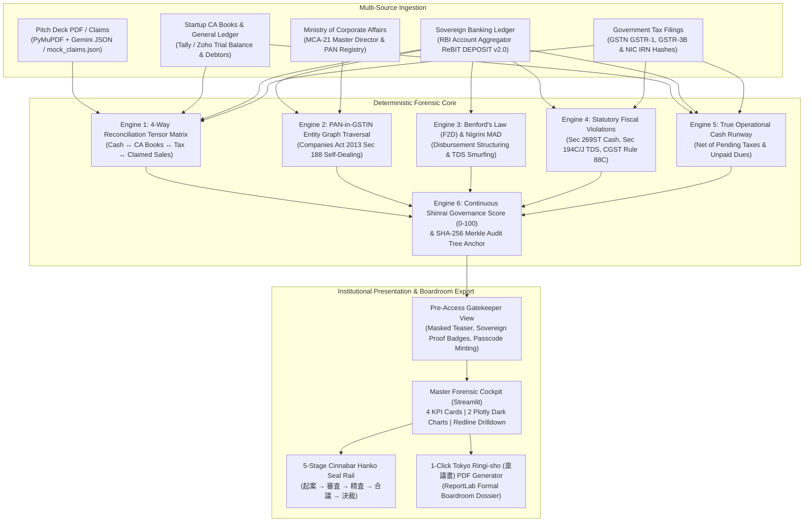

# VERILEDGER / KIZUNA-VAULT (絆)
### Automated Startup Financial & Governance Diligence Engine
**Track:** `OPEN-PS-01` (Open Innovation) — Thapar Japan Hackathon 2026 (TSLAS & TIET Patiala)  
**Primary Evaluators:** Corporate Venture Capital Teams (Value Create Inc. Tokyo), JETRO (Japan External Trade Organization), Faculty Reviewers  
**Design Standard:** `@non-ai-slop-ui-design` (Institutional Dark Slate, Bloomberg Density)  
**Math Standard:** 100% Deterministic Python (Zero Arithmetic Hallucination)

---

## 1. Executive Summary

Cross-border venture capital allocation between Japan and India faces a structural information verification deficit:
- **The PDF Mirage**: Virtual Data Rooms (Datasite, Intralinks) are passive file lockers; traditional accounting audits sample ~5% of general ledgers, missing systemic circular invoicing and promoter fund siphoning (e.g., Byju's $22B collapse, GoMechanic $75M confession).
- **The Regulatory Tower of Babel**: India's Digital Public Infrastructure (DPI: RBI Account Aggregator, GSTN e-invoices with signed IRNs, MCA21) is among the most advanced globally, but siloed in domestic compliance formats unintelligible to Tokyo boards operating under J-SOX and the TSE Corporate Governance Code.
- **The Point-in-Time Blindspot**: Deals are audited once over 14 weeks ($40,000+ cost); siphoning occurs in months 3 to 9 after funds land in the corporate account.

**VeriLedger** bridges this chasm by executing a sub-200ms deterministic reconciliation of **Startup CA Books (General Ledger / Trial Balance)**, **Pitch Deck Claims**, **Sovereign Banking Ledgers (RBI Account Aggregator ReBIT DEPOSIT v2.0)**, and **Government Tax Filings (GSTN GSTR-1 & GSTR-3B)**, delivering an executive boardroom dashboard with an automated Tokyo *Ringi-sho* (稟議書) approval circular stamped with authentic Cinnabar Hanko seals.

---

## 2. System Architecture Topology



---

## 3. The 4 Statutory & Forensic Formulations

All arithmetic executes in deterministic Python (NumPy / Pandas). LLMs are strictly used for unstructured textual claim extraction from pitch decks with zero calculation capabilities.

### 1. 4-Way Multi-Source Reconciliation Tensor
$$\vec{\Delta}_m = \begin{bmatrix} \delta_{\text{Tax}}(m) \\ \delta_{\text{Cash}}(m) \\ \delta_{\text{Books}}(m) \end{bmatrix}$$
- **Tax Under-Reporting**: $\delta_{\text{Tax}}(m) = \sum_{i \in \text{GSTR-1}(m)} \text{TaxableValue}(i) - \text{Turnover}(\text{GSTR-3B}(m))$
- **Phantom Revenue Gap**: $\delta_{\text{Cash}}(m) = \text{ReportedSales}(m) - (\text{ClearedCredits}(m) - \text{ContraTransfers})$

### 2. PAN-in-GSTIN Entity Graph (Companies Act 2013 Sec 188)
- Every Indian GSTIN encodes the counterparty's 10-digit PAN: $\text{VendorPAN} = \text{GSTIN}[2:12]$
- Traverses against MCA-21 Director PANs $\mathcal{P}_{\text{Directors}}$. An undisclosed match flags an immediate **Section 188 Promoter Siphoning Violation**.

### 3. Benford's Law (First-Two-Digits / F2D) & Nigrini MAD
$$P(D_1 D_2 = k) = \log_{10}\left(1 + \frac{1}{k}\right) \quad \text{for } k \in \{10, 11, \dots, 99\}$$
$$\text{MAD} = \frac{1}{90} \sum_{k=10}^{99} \left| \frac{\text{Observed}(k)}{N} - P(D_1 D_2 = k) \right|$$
- Non-conforming anomalies ($\text{MAD} \ge 0.0035$) flag artificial threshold evasion (transactions structured at ₹49,500 to evade ₹50,000 TDS limits under Section 194C/J).

### 4. True Operational Cash Runway
$$\text{NetOperationalCash} = \text{ClearedBankBalance} - \text{PendingGST} - \text{UnpaidTDS} - \text{Payables}$$
$$\text{TrueRunwayMonths} = \frac{\text{NetOperationalCash}}{\text{TrueMonthlyOperationalBurn}}$$

---

## 4. Quickstart Guide (Local Execution)

### Step 1: Install Dependencies
```powershell
pip install -r requirements.txt
```

### Step 2: Run Automated Test Suite
```powershell
python -m pytest tests/test_forensic_engine.py -v
```

### Step 3: Launch FastAPI Microservices (Checkpoint 1 Inspection)
```powershell
python -m uvicorn backend.main:app --port 8000 --reload
```
Interactive Swagger API documentation: `http://localhost:8000/docs`

### Step 4: Launch Streamlit Executive Cockpit
```powershell
python -m streamlit run frontend/app.py
```
Open `http://localhost:8501` in your browser.

---

## 5. Live Judging Demo Scenarios

Toggle between presets in the top navigation bar:

| Scenario | Target Startup | Sector | Trust Score | Classification | Smoking Gun Detected |
| :--- | :--- | :--- | :--- | :--- | :--- |
| **Clean Series A** | Apex AI Labs Pvt Ltd | Enterprise AI & SaaS | **94 / 100** | `[適格]` Clean | Zero conflicts, verified 98.4% bank match, 18.2 mo runway. |
| **Fraud Case** | PhantomTech Solutions | Cloud Logistics | **10 / 100** | `[精査要]` Reject | ₹1.54 Cr phantom revenue, ₹41.3L Sec 188 promoter siphoning, Benford TDS smurfing. |
| **Governance Debt**| LogiPulse Express | D2C Fulfillment | **64 / 100** | `[要確認]` Review | High operational burn, ₹42L unremitted GST tax, runway compressed to 2.4 months. |
| **Indo-Japan DeepTech**| Mirai Mobility Robotics | Industrial Robotics | **98 / 100** | `[適格]` Clean | Value Create CVC backed, J-SOX compliant, 100% bank-tax reconciliation. |

---

## 6. Project Layout

```text
c:\Users\brijk\Desktop\JAPAN/
├── backend/
│   ├── main.py              # FastAPI REST endpoints & Swagger UI
│   ├── schemas.py           # Pydantic data schemas
│   ├── forensic_rules.py    # Deterministic forensic math engine
│   └── claim_extractor.py   # Unstructured PDF text extraction
├── frontend/
│   └── app.py               # Streamlit executive cockpit (Dark Slate)
├── export/
│   └── memo_generator.py    # ReportLab Tokyo Ringi-sho (稟議書) PDF generator
├── data/
│   ├── clean_startup_rebit.json
│   ├── clean_startup_gst.csv
│   ├── clean_startup_ca_books.json
│   ├── fraud_startup_rebit.json
│   ├── fraud_startup_gst.csv
│   ├── fraud_startup_ca_books.json
│   ├── logipulse_rebit.json
│   ├── mirai_rebit.json
│   ├── mca_directors.csv
│   └── mock_claims.json
├── tests/
│   └── test_forensic_engine.py
├── scripts/
│   └── generate_datasets.py
├── requirements.txt
└── README.md
```
